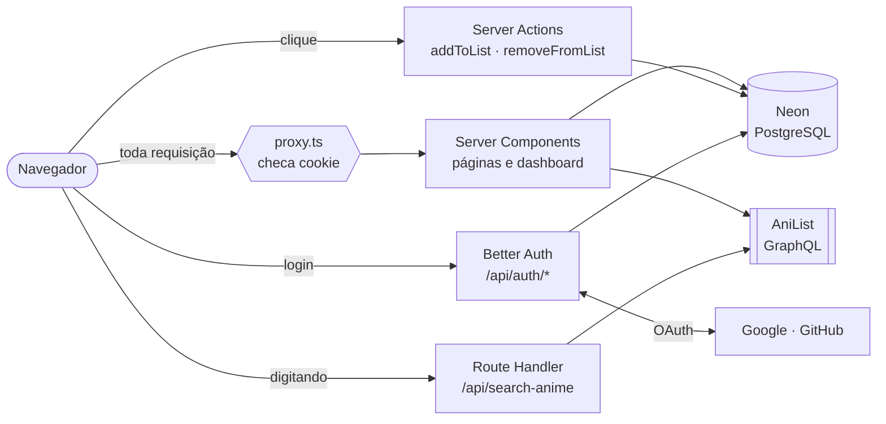
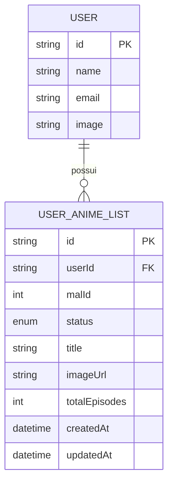

<div align="center">


<br />

**Organize, acompanhe e descubra animes.**
Uma aplicação full stack em produção, com autenticação completa, listas por status e dashboard de estatísticas.

<br />

[](https://anime-dex-eight-chi.vercel.app)
[](https://anime-dex-eight-chi.vercel.app)


</div>

---

## 📑 Sumário

- [Visão geral](#-visão-geral)
- [Funcionalidades](#-funcionalidades)
- [Stack](#-stack)
- [Arquitetura](#-arquitetura)
- [Decisões técnicas](#-decisões-técnicas)
- [Modelo de dados](#-modelo-de-dados)
- [Rotas](#-rotas)
- [Segurança](#-segurança)
- [Rodando localmente](#-rodando-localmente)
- [Deploy](#-deploy)
- [Roadmap](#-roadmap)
- [Autor](#-autor)

---

## 🎯 Visão geral

O **AnimeDex** é um tracker pessoal de animes. A pessoa cria uma conta (e-mail, Google ou GitHub), busca qualquer anime, abre a página de detalhes e marca em que ponto está: **Assistindo**, **Completo**, **Quero Assistir** ou **Dropado**. Uma dashboard resume tudo em números, gráfico e atividade recente.

O projeto tem uma regra central: **dados descritivos nunca são duplicados no banco**. Sinopse, banner, nota e estúdio são buscados frescos no AniList a cada visita. O PostgreSQL guarda só o que pertence à pessoa: quem adicionou, qual anime e em qual status.

> **Identidade visual:** painéis de mangá encontram a Pokédex. Bege-papel `#F7F4ED`, preto-tinta `#111111`, vermelho-hanko `#E8352C`, bordas grossas com sombra deslocada e zero cantos arredondados.

---

## ✨ Funcionalidades

<table>
<tr>
<td width="50%" valign="top">

### 🔐 Autenticação
- Cadastro e login com e-mail e senha
- Login social com **Google** e **GitHub**
- Sessão por cookie, validada no servidor
- Rotas protegidas em duas camadas (proxy + página)

### 🔎 Descoberta
- Fileiras por gênero e “mais assistidos”
- Carrossel horizontal com setas inteligentes
- Busca com **autocomplete**, debounce e cancelamento de requisições
- Página de detalhe estilo streaming, com banner, pôster e trailer

</td>
<td width="50%" valign="top">

### 📚 Listas pessoais
- Quatro status por anime
- Botão com popover que **reflete o banco** ao recarregar
- Adicionar, trocar de status e remover
- Operações idempotentes (`upsert` e `deleteMany`)

### 📊 Dashboard
- Contagem por status e gráfico proporcional
- Feed de atividade recente em estilo terminal
- Lista por categoria com “Ver todos”
- **Paginação no servidor**, 10 itens por página, via `?page=`

</td>
</tr>
</table>

---

## 🧰 Stack

| Camada | Tecnologia | Papel |
| :-- | :-- | :-- |
| **Framework** | Next.js 16 (App Router, Turbopack) | Server Components, Server Actions, Route Handlers, `proxy` |
| **Linguagem** | TypeScript | Tipos de ponta a ponta, `Record` para garantir completude |
| **UI** | Tailwind CSS v4 · shadcn/ui (Base UI) | Estilo utilitário e componentes acessíveis |
| **Animação** | react-bits | `DecryptedText` e `ElectricBorder` no Header |
| **Autenticação** | Better Auth | Sessão, e-mail e senha, Google e GitHub |
| **Banco** | Neon (PostgreSQL serverless) | Usuários, sessões e listas |
| **ORM** | Prisma 7 + `@prisma/adapter-neon` | Consultas tipadas e migrations |
| **Formulários** | React Hook Form + Zod | Validação com um esquema único |
| **Dados externos** | AniList (GraphQL) | Catálogo de animes |
| **Hospedagem** | Vercel | Deploy contínuo a cada push |

---

## 🏗 Arquitetura



**Quem dispara decide a ferramenta:**

| Gatilho | Ferramenta | Exemplo no projeto |
| :-- | :-- | :-- |
| A pessoa abre uma página | **Server Component** | Dashboard, detalhe, “Ver todos” |
| A pessoa clica e algo precisa ser gravado | **Server Action** | `addToList`, `removeFromList` |
| O navegador consulta várias vezes sem trocar de página | **Route Handler** | Autocomplete da busca |

---

## 🧠 Decisões técnicas

<details open>
<summary><b>Pai no servidor, filho “burro” no cliente</b></summary>
<br />

Quem busca e decide é um Server Component. Quem só desenha recebe props prontas e não conhece banco, API nem sessão. Isso permite refazer o visual sem tocar em nenhuma consulta, e reaproveitar o mesmo cartão (`DashboardAnimeCard`) em mais de uma tela.

</details>

<details>
<summary><b>Tipo interno estável</b></summary>
<br />

O app nunca espalha o formato do AniList. Uma única função converte a resposta externa para tipos próprios (`AnimeCardData`, `AnimeDetailData`, `DashboardListItem`). Quando a API anterior foi descontinuada, só essa conversão mudou. O `idMal` serve como chave estável, e as listas salvas continuaram válidas.

</details>

<details>
<summary><b>Persistir só o necessário, mais uma cópia leve</b></summary>
<br />

O banco guarda o `malId` e uma cópia leve (`title`, `imageUrl`, `totalEpisodes`) gravada ao adicionar. Detalhes e sinopse vêm sempre frescos da API. O ganho é evitar uma chamada ao AniList por anime a cada carregamento da dashboard.

</details>

<details>
<summary><b>Paginação na URL, com a lógica no servidor</b></summary>
<br />

`/dashboard/completo?page=3` carrega a página pedida com `skip` e `take`, e o total vem de um `count` rodando em paralelo (`Promise.all`). Sem estado no cliente: links compartilháveis e o botão “voltar” do navegador funcionando.

```ts
const [total, animes] = await Promise.all([
  prisma.userAnimeList.count({ where: { userId, status } }),
  prisma.userAnimeList.findMany({
    where: { userId, status },
    orderBy: { updatedAt: "desc" },
    take: PAGE_SIZE,
    skip: (currentPage - 1) * PAGE_SIZE,
  }),
]);

const totalPages = Math.ceil(total / PAGE_SIZE);
```

</details>

<details>
<summary><b>Busca que não se atropela</b></summary>
<br />

Mínimo de 4 caracteres, debounce de 400 ms e `AbortController` para cancelar a requisição anterior. O retorno do `useEffect` limpa o timer pendente e a requisição em andamento ao mesmo tempo, então uma resposta antiga e lenta nunca sobrescreve uma nova.

</details>

<details>
<summary><b>Estado do botão vindo do banco</b></summary>
<br />

O status atual é consultado no servidor (`findUnique` pela chave composta `userId + malId`) e desce por props até o botão, que o usa como valor inicial. Ao recarregar, o botão continua mostrando “✓ Completo”.

</details>

---

## 🗃 Modelo de dados



- `status` é um enum: `WATCHING` · `COMPLETED` · `PLAN_TO_WATCH` · `DROPPED`
- `@@unique([userId, malId])` impede duplicatas e habilita `upsert` e `findUnique`
- `onDelete: Cascade` remove as listas junto com o usuário

---

## 🧭 Rotas

| Rota | Descrição | Acesso |
| :-- | :-- | :-- |
| `/` | Landing page | Público |
| `/login` · `/register` | Entrar e criar conta | Público |
| `/explore` | Fileiras por gênero, mais assistidos e busca | Logado |
| `/explore/[malId]` | Detalhe do anime e botão de status | Logado |
| `/dashboard` | Estatísticas, atividade e categorias | Logado |
| `/dashboard/[status]` | Lista completa de uma categoria, paginada | Logado |
| `/privacy` | Política de privacidade | Público |
| `/api/auth/*` | Better Auth (login, cadastro, callbacks OAuth) | — |
| `/api/search-anime` | Autocomplete da busca | — |

---

## 🛡 Segurança

- **A sessão é a única fonte do usuário.** O `userId` é lido no servidor, dentro de cada página e Server Action, e nunca é um parâmetro vindo do navegador.
- **Toda entrada externa é validada antes do banco:** o slug da URL passa por `Object.hasOwn`, o `?page=` por `Number` + `Number.isInteger` + `> 0`, e páginas além do fim são redirecionadas.
- **Duas camadas de proteção de rota:** o `proxy.ts` filtra cedo pelo cookie; a página confirma a sessão de verdade.
- **Consultas sempre filtradas por usuário**, então ninguém enxerga a lista de outra pessoa.
- **Segredos fora do repositório**, em variáveis de ambiente.

---

## 🚀 Rodando localmente

**Pré-requisitos:** Node.js 20+, um banco PostgreSQL (o projeto usa o [Neon](https://neon.tech)) e, para o login social, apps OAuth no Google e no GitHub.

```bash
# 1. Clone o repositório
git clone https://github.com/7alexandree7/anime-dex.git
cd anime-dex

# 2. Instale as dependências (o postinstall já roda o prisma generate)
npm install

# 3. Configure as variáveis de ambiente
cp .env.example .env   # ou crie o arquivo manualmente

# 4. Aplique o schema no banco
npx prisma migrate dev

# 5. Rode o projeto
npm run dev
```

Abra [http://localhost:3000](http://localhost:3000).

<details>
<summary><b>🔑 Variáveis de ambiente</b></summary>
<br />

```env
# Banco (use a string "pooled" do Neon)
DATABASE_URL=

# Better Auth
BETTER_AUTH_SECRET=
NEXT_PUBLIC_BETTER_AUTH_URL=http://localhost:3000

# Login social
GOOGLE_CLIENT_ID=
GOOGLE_CLIENT_SECRET=
GITHUB_CLIENT_ID=
GITHUB_CLIENT_SECRET=
```

**Callbacks OAuth** a cadastrar em cada provedor:

| Provedor | URL de callback |
| :-- | :-- |
| Google | `http://localhost:3000/api/auth/callback/google` |
| GitHub | `http://localhost:3000/api/auth/callback/github` |

> ⚠️ Nunca faça commit do `.env`. Ele já está no `.gitignore`.

</details>

<details>
<summary><b>📜 Scripts</b></summary>
<br />

| Comando | O que faz |
| :-- | :-- |
| `npm run dev` | Servidor de desenvolvimento |
| `npm run build` | Build de produção (checa tipos e compila com Turbopack) |
| `npm run start` | Serve o build de produção |
| `npx prisma generate` | Gera o client do Prisma (roda sozinho no `postinstall`) |
| `npx prisma migrate dev` | Cria e aplica migrations em desenvolvimento |

</details>

---

## ☁️ Deploy

O projeto roda na **Vercel**, com deploy a cada push na branch `main`.

1. Importe o repositório na Vercel.
2. Cadastre as variáveis de ambiente (em produção, `NEXT_PUBLIC_BETTER_AUTH_URL` aponta para o domínio publicado).
3. Registre os callbacks de produção no Google e no GitHub (`https://SEU-DOMINIO/api/auth/callback/...`).
4. Publique a tela de consentimento do Google, que exige a página inicial e a política de privacidade (`/privacy`).

> 💡 O `postinstall` com `prisma generate` é obrigatório: o client gerado fica fora do repositório, e sem ele o build na Vercel não encontra `./generated/prisma/client`.

---

## 🗺 Roadmap

- [x] Autenticação com e-mail, Google e GitHub
- [x] Busca com autocomplete
- [x] Listas por status com persistência
- [x] Dashboard com estatísticas e atividade
- [x] “Ver todos” com paginação no servidor
- [x] Remoção de itens da lista
- [x] Deploy em produção
- [ ] Estados de carregamento (`loading.tsx` e esqueletos)
- [ ] Páginas de erro por rota (`error.tsx`)
- [ ] Testes automatizados
- [ ] Banco separado para desenvolvimento
- [ ] Metadados e SEO por página

---

## 👤 Autor

**Alexandre Oliveira** · Desenvolvedor Full Stack

[](https://github.com/7alexandree7)

<div align="center">

<sub>Feito com Next.js, café e muitos episódios.</sub>

</div>
